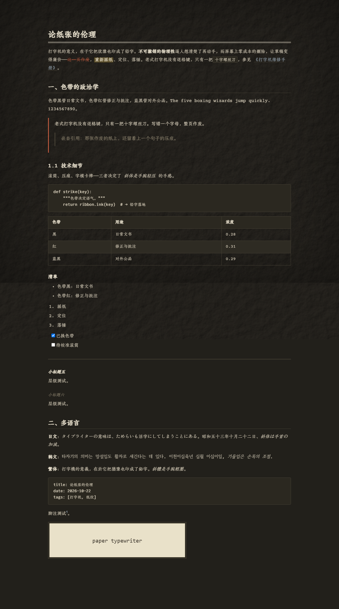

# Paper Typewriter

**老式打字机纸纹主题 for Typora** — 做旧纸纹随文字 1:1 滚动、随光标视差，Courier 系打字机字体 + 朱雀仿宋，明暗双模，护眼暖色。

**[▶ 在线 Demo](https://julian-donald-von.github.io/paper-typewriter-theme/demo/demo.html)** ｜ **[下载主题](https://github.com/Julian-Donald-Von/paper-typewriter-theme/archive/refs/heads/theme-source.zip)** ｜ [安装步骤](#一快速开始)

| 浅色 | 暗色 |
|:---:|:---:|
|  |  |

| | |
|---|---|
| **纸纹** | 预烘焙纸纤维（feTurbulence + feDiffuseLighting）+ 中性噪点 + 四缘晕影，纸色零漂移（误差 0.5/255） |
| **随动** | 纸张与文字 1:1 同步滚动；可选光标视差（CDP 注入，不改 Typora 本体） |
| **字体** | Courier Prime / 朱雀仿宋 / TeX Gyre Cursor / Commit Mono / Patrick Hand / Zen Old Mincho / Gowun Batang，全部 SIL OFL 本地打包 |
| **护眼** | 暖纸 `#f1ead8` + 暖墨 `#443d33`，正文对比 8.92:1，行高 1.8，纹理不改有效对比度 |
| **兼容** | 打字机模式（最后一行居中）· 专注模式 · 源码模式 · 导出 PDF（自动切白纸黑墨）· 全部官方 UI 变量 |
| **体积** | 主题本体 9.2MB（20 个 woff2 子集自带，离线可用） |

> Demo 是**单文件自包含**的（CSS 与字体内嵌，2.3MB）——在线看或下载后双击都行，由 `demo/demo.md` 经 `tools/build_demo.py` 渲染生成。

---

## 一、快速开始

1. 把本文件夹里的 **`paper-typewriter.css`、`paper-typewriter.meta.json`、`paper-typewriter/` 三样**一起复制到 Typora 主题文件夹：
   - Windows：`%APPDATA%\Typora\themes\`
   - macOS：`~/Library/Application Support/abnerworks.Typora/themes/`
   - 打开方式：Typora → 偏好设置 → 外观 → 打开主题文件夹
2. 重启 Typora（或切换一次主题），菜单栏 **主题 → Paper Typewriter**。

> 目录必须保持同级结构（css 在 themes 根、资产在 `paper-typewriter/` 子目录），否则字体与纸纹加载不到。

### 看效果

- Typora 里打开 `demo/demo.md`（覆盖全部排版元素）；
- 或浏览器直接打开 `demo/demo.html`：**单文件自包含**（在线版：<https://julian-donald-von.github.io/paper-typewriter-theme/demo/demo.html>）（CSS 与字体全部内嵌成 data URI，2.4MB），双击即可看，不依赖任何外部文件；由 `demo/demo.md` 经 `tools/build_demo.py` 渲染生成（pymdown 扩展，`~~删除线~~`/`==高亮==`/任务列表/front matter 都按 Typora 语义还原；公式降级为等宽显示）。

---

## 二、目录结构

```
paper-typewriter-package/
├─ paper-typewriter.css          # 主题样式（单文件，含暗色媒体查询）
├─ paper-typewriter.meta.json    # 主题元数据（名称/作者/标签）
├─ paper-typewriter/
│  ├─ fonts/                     # 18 个 woff2 子集（约 9MB，全部 SIL OFL / LPPL，可随主题分发）
│  ├─ img/                       # 预烘焙纸纤维 SVG + 中性噪点 PNG
│  └─ follow/                    # 「纸随光标」随动脚本（可选，见第五节）
├─ tools/
│  └─ build_demo.py              # 由 demo.md 生成自包含 demo.html
├─ demo/
│  ├─ demo.md                    # 元素展示文档（Typora 打开）
│  ├─ demo.html                  # 自包含静态预览（2.4MB，单文件可分发）
│  ├─ preview-light.png / preview-dark.png
├─ README.md
```

主题运行时只用到 `paper-typewriter.css` + `paper-typewriter/`，`demo/` 与 `README.md` 是说明物料，可不装。

---

## 三、字体

| 用途 | 字体 | 许可 |
|---|---|---|
| 正文拉丁 | **Courier Prime**（打字机标准，四式） | SIL OFL 1.1 |
| 正文中文（简/繁） | **朱雀仿宋** v0.212（民国「南宋」活字复刻，11472 字形） | SIL OFL 1.1 |
| 标题 | **TeX Gyre Cursor**（Courier 正统重制，笔画更重，四式齐全）+ 中文回退朱雀 | GUST / LPPL 1.3c+ |
| 代码 / 公式 | **Commit Mono**（低对比几何骨架，笔画如机械压印） | SIL OFL 1.1 |
| 引用 / 脚注（旁批） | **Patrick Hand**（英文手写）+ **朱雀仿宋**（中文，与正文同源） | SIL OFL 1.1 |
| 日文 | **Zen Old Mincho**（旧字風明朝，Regular + SemiBold） | SIL OFL 1.1 |
| 韩文 | **Gowun Batang**（古风 바탕，Regular + Bold） | SIL OFL 1.1 |

按字符回退：拉丁→对应拉丁字体；简体汉字→朱雀仿宋；假名与日文独有字形→Zen Old Mincho；韩文→Gowun Batang。
每个角色都是「拉丁字体 + 朱雀仿宋」配对（正文 Courier Prime、标题 TeX Gyre Cursor、代码 Commit Mono、旁批 Patrick Hand），中文始终同源，不会出现混排。

> 字体可用性已逐个核验（字形数 / 拉丁·汉字·假名·韩文覆盖）：Courier Prime 246、Zhuque Fangsong 11472（简繁）、Zen Old Mincho 7452（假名）、Gowun Batang 11844（韩文）、Commit Mono 744、TeX Gyre Cursor 239、Patrick Hand 199（纯拉丁）。
> 曾试用的「霞鹜文楷 GB」仅 1291 字形、中文覆盖不全（旁批会掉字回退），已弃用并从包内移除。

> 关于「朱雀看起来像楷体」：这是它的设计取向而非故障——以民国「南宋」活字为蓝本、v0.212 预览版刻意削弱笔画对比度，笔画带顿挫与书写味。已实测排除渲染/打包问题（字体栈正确、`document.fonts.check` 通过、官方 TTF 与子集渲染一致）。

---

## 四、纸纹系统

Typora 主题只能加载 CSS、不能注入 DOM，纸纹全部由**预烘焙资产 + 伪元素**实现：

| 层 | 伪元素 | 资产 | 混合 | 作用 |
|---|---|---|---|---|
| 纸纤维 | `#write::before` | `paper-fiber-a.svg` | `background-blend-mode: multiply` | 纸张主体（`feTurbulence` + `feDiffuseLighting` 烘焙，均值补偿到 0.968） |
| 噪点 | `html::before` | `grain-tile.png` | `mix-blend-mode: overlay` | 中性噪点，均值钉 128，零均值漂移（不伤对比度） |
| 晕影 | `html::after` | — | `box-shadow: inset` | 四缘压暗，减少眩光 |

- **纸色零漂移**：`--paper-raw`（乘算输入色）× 纤维均值 0.968 = 有效纸色 `--paper`。改纸色时必须同步 `--paper-raw = --paper ÷ 0.968`。
- **纸张与文字 1:1**：纸层挂在 `#write` 上——它在 Typora 真正的滚动容器 `<CONTENT>` 内部，滚动时与文字同速，像一整张纸铺在字底下。
- 暗色用单独烘焙的暗色纤维（均值 0.848）：暗纸上 multiply 的动态余量极小，浅色参数在暗底上不可见。

**⚠️ 改主题前必读的三条硬约束**（都踩过坑）：

1. **不要给 `body` 加 `position: relative`**。Typora 的 `<CONTENT>`（编辑器滚动容器）是 `position:absolute`、以初始包含块为基准，而 body 无流内内容（`window.css` 有 `body{height:100%;overflow:hidden}`，实高 0）。body 一旦成为定位元素，`<CONTENT>` 改以 body 为基准会塌成 0 高——**文字与纸纹全部消失**。
2. **不要占用 `#write::after`**。打字机模式靠注入 `#write:after{height:Mpx}` 把最后一行顶到屏幕中心（该伪元素在 `base-control.css` 里预置为 `content:"";display:block;height:0` 的行内占位块）。用 `position:absolute` 占用它 ⇒ 占位失效 ⇒ 最后一行沉底。
3. **纸层不要上下外扩**（`top/bottom:0`）。竖溢出的绝对定位元素会撑大 `<CONTENT>` 的滚动高度，滚到底时最后一行被顶偏同样的距离。

---

## 五、随动（纸随文字 / 纸随光标）

**① 纸随文字（纯 CSS，开箱即用）**：见上，纸层在滚动容器内，天然 1:1。

**② 纸随光标（需要随动脚本，可选）**：Typora 主题读不到指针位置（官方 `setTheme` 只加载 `.css`），所以由 `paper-typewriter/follow/` 提供：

```
follow/
├─ paper-follow.js   # pointermove → rAF → 写 --paper-px/--paper-py（最大位移 26px）
├─ inject.py         # 走 Chrome DevTools 协议注入，不修改 Typora 本体
└─ 启动随动.bat      # 一键：以调试端口启动 Typora + 注入
```

用法：**先从托盘完全退出 Typora**（Electron 单实例会把启动参数转发给已运行的实例，端口开不了），再双击 `启动随动.bat`。

一劳永逸：Typora 偏好设置 → 打开高级设置（`conf/user.json`）加

```json
"flags": [
  ["remote-debugging-port", "9333"],
  ["remote-allow-origins", "*"]
]
```

之后每次启动 Typora 都带端口，再跑一次 `inject.py`（或设为开机自启）即可。**脚本缺席时纸张仍与文字 1:1，视觉完整**，只是不跟指针。

> 需要 Python 3 + `websocket-client`（`pip install websocket-client`）。Chrome 111+ 的 WebSocket 握手必须带 `--remote-allow-origins`，缺了会 403。

---

## 六、与 Typora 原生功能的兼容

| 功能 | 状态 | 说明 |
|---|---|---|
| 打字机模式（光标居中） | ✅ 实测 | 最后一行可居中：实测偏差 −28px（原生主题基线 −24px） |
| 专注模式 | ✅ 实测 | 聚焦块保持正文色，非聚焦块与子元素淡化到 `--blur-text-color` |
| 源码模式 | ✅ | 等宽栈 + 行内代码配色 |
| 大纲 / 侧边栏 / 菜单 / 对话框 | ✅ | 全部走官方 UI 变量 |
| 导出 PDF | ✅ | 打印样式自动切白纸黑墨、剥离纹理 |
| 导出 HTML | ⚠️ | 纹理与字体资产不随导出内嵌（所有本地资源主题通例） |

专注模式的淡化交给 Typora 官方机制（`base-control.css` 用 `--blur-text-color !important` 淡化 `.md-end-block` 的子元素与 `li[cid]`），主题只负责把该变量配成纸族色，并补一条「块本身」的淡化（官方 `*` 规则覆盖不到裸文本）。**不要自造 `opacity` 规则**（会双重发灰），也不要蹭 `.typewriter-mode .md-end-block:not(.md-focus)`（打字机模式没有 `md-focus` 类，会冲淡整篇）。

---

## 七、UI 主题变量

Typora 的全部原生 UI（设置面板、对话框、按钮、输入框、菜单、侧边栏）由一套官方 CSS 变量驱动。本主题在 `[COLORS]` 区定义了完整变量表（明/暗双值，全部映射纸族色板），在 `[UI-VARS]` 区对 bootstrap 残留控件（`.btn-default` / `.long-btn` / `.form-control` 继承链）做显式兜底。

未定义这些变量时，UI 会掉回 Typora 默认的白底蓝钮；暗色下更会出现深色字配深色底（如 megamenu 大按钮不可读）。UI 对比度实测：元素级 18/20 达标（2 项为空文件树中的元素）、变量级状态对 20/20 达标，最低 5.08:1。

---

## 八、护眼设计

- **暖纸 `#f1ead8`**：无纯白眩光、低蓝光，亮度介于白纸与豆沙绿之间；
- **暖墨 `#443d33`**：不用纯黑，正文对比 **8.92:1**（暗色 10.51:1）；
- **行高 1.8、版心 860px**：减少换行追踪疲劳；
- **纹理零漂移**：噪点均值钉 128、纤维均值补偿 0.968，纹理不改变有效对比度；
- **暗色碳纸 `#22201b` + 暖灰墨 `#d8cfbb`**：夜间低亮暖色；
- 晕影压暗四缘，减少页面眩光。

---

## 九、自定义入口（CSS 内搜标签）

| 标签 | 内容 |
|---|---|
| `[COLORS]` | 全部颜色变量（浅色 + 暗色）+ 官方 UI 变量表。改 `--paper` 需同步 `--paper-raw = --paper ÷ 0.968` |
| `[FONTS]` | 字体栈（`--font-body` / `--font-heading` / `--font-code` / `--font-hand`） |
| `[PAPER]` | 纸层、噪点、晕影、指针视差变量 |
| `[LAYOUT]` | 版心宽度、行高、字号 |
| `[ELEMENTS]` | 标题/正文/代码/表格/引用/列表/图片/脚注 |
| `[UI]` | 侧边栏/大纲/源码模式/菜单/滚动条 |
| `[UI-VARS]` | 控件兜底（按钮/输入框/模态框） |
| `[PRINT]` | 打印与导出 PDF |

常用微调：

```css
/* 更宽的版心 */
#write { max-width: 980px; }
/* 纸色更黄一点（记得同步改 --paper-raw = 新纸色 ÷ 0.968） */
:root { --paper: #f3ecd6; --paper-raw: #fbf3dd; }
/* 指针视差更明显（改 follow/paper-follow.js 里的 AMP） */
```

---

## 十、验证与重跑

主题附带可复跑的验证脚本（在开发版 `tools/` 与 `follow/` 中，需 Python 3 + Playwright + 本机 Chrome）：

| 验证项 | 脚本 | 结果 |
|---|---|---|
| 纸色 / 纸纹存在 / 正文对比度 | `tools/verify2.py` | 9/9（纸色误差 0.5/255） |
| 导出 PDF 白纸黑墨 | `tools/verify_export.py` | 主色纯白、纸色残留 0.000% |
| 打字机模式最后一行居中 / 专注模式淡化 | `tools/ui-audit/verify_modes.py` | 6/6 |
| 纸随文字 1:1 / 指针视差 / 注入链 | `follow/verify_follow.py` | 5/5 |
| UI 元素级 / 变量级对比度 | `tools/ui-audit/run_audit.py`、`verify_ui_vars.py` | 18/20、20/20 |

验证方法学：复刻真实 Typora 窗口（`window.html` + 官方 CSS）在 Chromium 里跑——**不要设 `body.minHeight`**，否则会遮住真实结构（body 高 0、`<CONTENT>` 滚动、窗口不滚）。

---

## 十一、已知限制

- 指针视差需外部注入（Typora 主题机制限制）；未注入时纸张仍与文字 1:1。
- 中文粗体为浏览器合成（朱雀仿宋单字重）。
- 导出 HTML 不内嵌纹理与字体。
- 需较新 Electron（Chromium 88+）；纸纹与常规排版不受影响。

---

## 十二、许可

- 主题 CSS：**MIT**
- 字体：均为开源许可（SIL OFL 1.1 / LPPL 1.3c+），允许随主题分发；单独售卖字体文件属违规。

素材来源：纸纤维与噪点由本主题自烘焙（`feTurbulence` + `feDiffuseLighting`）；参考了 retro-typewriter（变量分区结构）、newsprint（@font-face 打包）、github（woff2 打包范式）三个官方/社区主题的工程做法。
