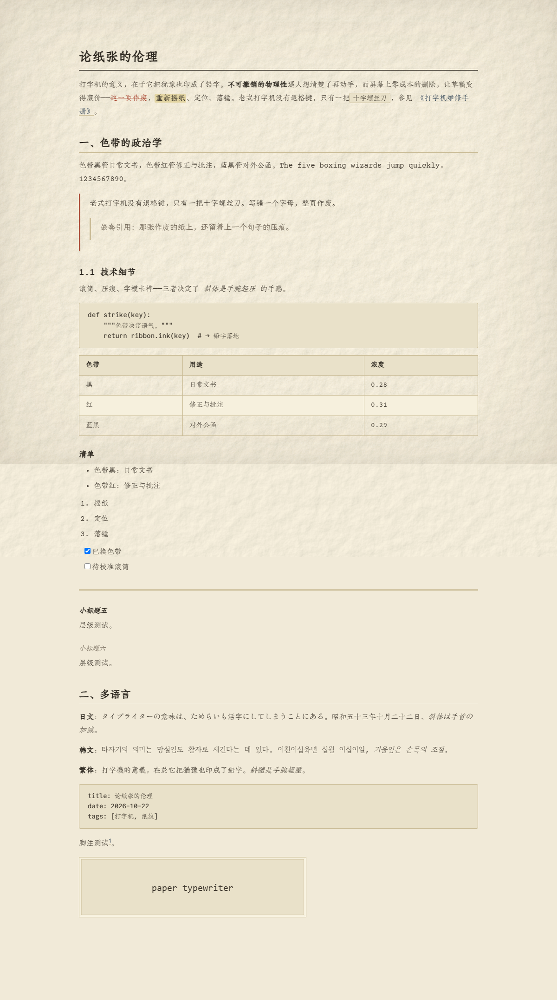

# 论纸张的伦理

> 元素展示文档：用 Typora 打开本文件（主题选 **Paper Typewriter**），可以一次看全本主题的排版。下面每一节都对应一类 markdown 元素。

打字机的意义，在于它把**犹豫也印成了铅字**。不可撤销的物理性逼人想清楚了再动手，而屏幕上零成本的删除，让草稿变得廉价——~~这一页作废~~，==重新摇纸==、定位、落锤。老式打字机没有退格键，只有一把 `十字螺丝刀`，参见 [《打字机维修手册》](#)。

## 一、标题层级

### 三级标题

#### 四级标题

##### 五级标题（斜体）

###### 六级标题（灰）

## 二、行内样式

**粗体**用正文粗，*斜体*是手腕轻压，`行内代码` 有纸色底与细边框，~~删除线~~ 是色带红，==高亮== 是打字机色带压出的浅黄。链接默认墨蓝黑、悬停转色带红：[示例链接](#)。

组合：**粗体里的 *斜体* 与 `代码`**，***粗斜体***。

## 三、引用（手写旁批）

> 老式打字机没有退格键，只有一把十字螺丝刀。写错一个字母，整页作废。
>
> > 嵌套引用：那张作废的纸上，还留着上一个句子的压痕。

引用块用手写体（英文 Patrick Hand / 中文霞鹜文楷），像用钢笔写在打印稿的页边。

## 四、代码

```python
def strike(key, ribbon="black"):
    """色带决定语气。"""
    return ribbon.ink(key)  # → 铅字落地


def retype(page):
    page.discard()      # 没有 Ctrl+Z
    return strike("A")
```

行内代码 `--paper-raw ÷ 0.968`、`position: absolute` 用 Commit Mono，与纸纹融得最好。

## 五、表格

| 色带 | 用途 | 浓度 | 备注 |
|---|---|---|---|
| 黑 | 日常文书 | 0.28 | 最常用 |
| 红 | 修正与批注 | 0.31 | 色带红 |
| 蓝黑 | 对外公函 | 0.29 | 复写纸 |

## 六、列表

- 无序项一
- 无序项二
  - 嵌套项
- 无序项三

1. 摇纸
2. 定位
3. 落锤

- [x] 已换色带
- [ ] 待校准滚筒

## 七、分隔线

---

（上面是一枚双线分隔符。）

## 八、公式

行内公式 $E = mc^2$，块级：

$$
\int_{0}^{1} \frac{\partial \rho}{\partial t} \, dt = \rho(1) - \rho(0)
$$

## 九、多语言混排

**日文**：タイプライターの意味は、ためらいも活字にしてしまうことにある。昭和五十三年十月二十二日、*斜体は手首の加減*。

**韩文**：타자기의 의미는 망설임도 활자로 새긴다는 데 있다. 이천이십육년 십월 이십이일, *기울임은 손목의 조절*.

**繁体**：打字機的意義，在於它把猶豫也印成了鉛字。*斜體是手腕輕壓*。

拉丁与数字：The quick brown fox jumps over the lazy dog. 0123456789 — “引号” ‘单引号’ … ½ ¼ ⅓。

## 十、脚注与图片

脚注测试[^1]，第二个脚注[^2]。



[^1]: 脚注用旁批字体：英文 Patrick Hand 手写、中文朱雀仿宋，像用铅笔写在页脚。
[^2]: 这是第二条脚注。

## 十一、打字机模式 / 专注模式

- **打字机模式**（视图 → 打字机模式）：光标所在行始终停在屏幕中线。本主题已适配——纸层不占用 `#write::after` 占位块，滚到文档末尾时最后一行仍能居中。
- **专注模式**（视图 → 专注模式）：当前段落保持正文色，其余淡化到 `--blur-text-color`。

> 建议开一段长文，把这两模式都试一遍——纸纹会跟着文字一起滚，不会动的是噪点与四缘晕影。
